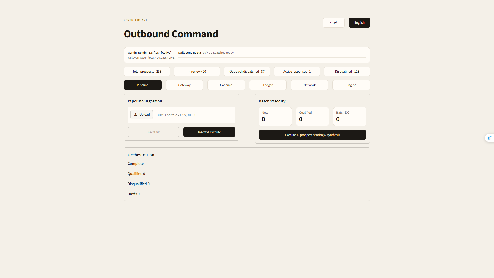

# AI Outbound - Lead Qualification & Outreach Assistant

A local, human-in-the-loop outbound sales tool. You import a lead export (for example from Apollo), an LLM filters the leads and drafts a personalized email for each one, you approve or reject every draft, and the system handles sending and scheduled follow-ups.

There is no Apollo API integration, so your credits stay under your control.

## What it does

- **Lead ingestion:** CSV import with pre-filtering of unsuitable leads.
- **LLM qualification and drafting:** a local Qwen model (via LM Studio) or Google Gemini, with model failover and rate limiting.
- **Human approval:** nothing is sent until you approve the draft.
- **Sending:** SMTP (Zoho) with daily send limits, throttling and attachments.
- **Follow-ups:** a multi-step follow-up sequence, run from the dashboard or from a background worker.
- **Dashboard:** Streamlit UI, bilingual (English / Arabic).
- **Storage:** SQLite, created automatically on first run.

## Stack

Python, Streamlit, SQLite, SMTP (Zoho), LM Studio (Qwen) and Google Gemini.

## Run it

```bash
python -m venv .venv
.venv\Scripts\activate
pip install -r requirements.txt
copy .env.example .env      # then fill in your own keys
streamlit run app.py
```

Open http://localhost:8501

For follow-ups while the browser is closed:

```bash
python worker.py
```

## Configuration

Copy `.env.example` to `.env` and set `GEMINI_API_KEY` (if using Gemini) and your SMTP details. For a local model, load it in LM Studio, which is expected at `http://127.0.0.1:1234/v1`. Company name, signature and offer text are set from the dashboard settings.

## Privacy

This repository contains code only. No real lead data, databases, API keys or credentials are included. The database is created locally on first run.

## Screenshot



